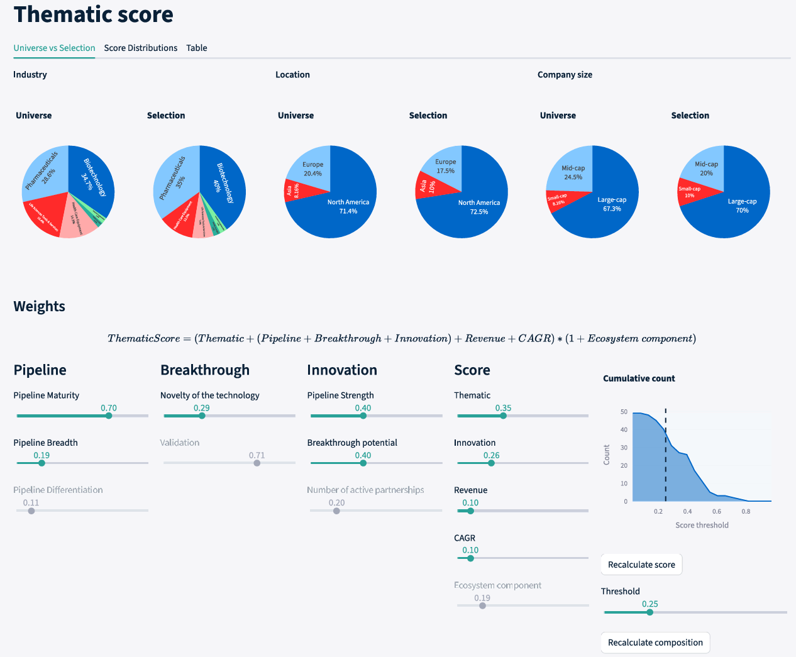
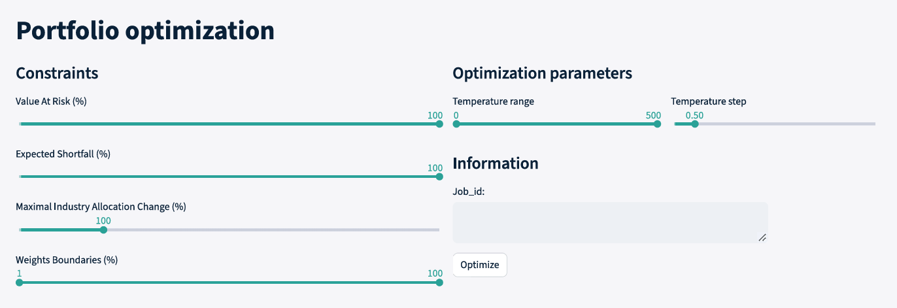
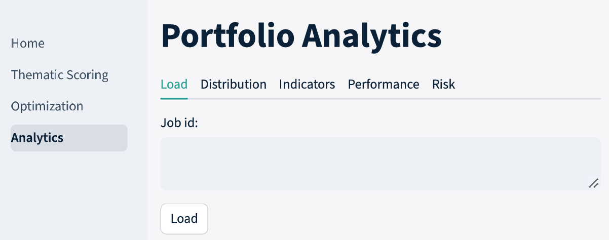
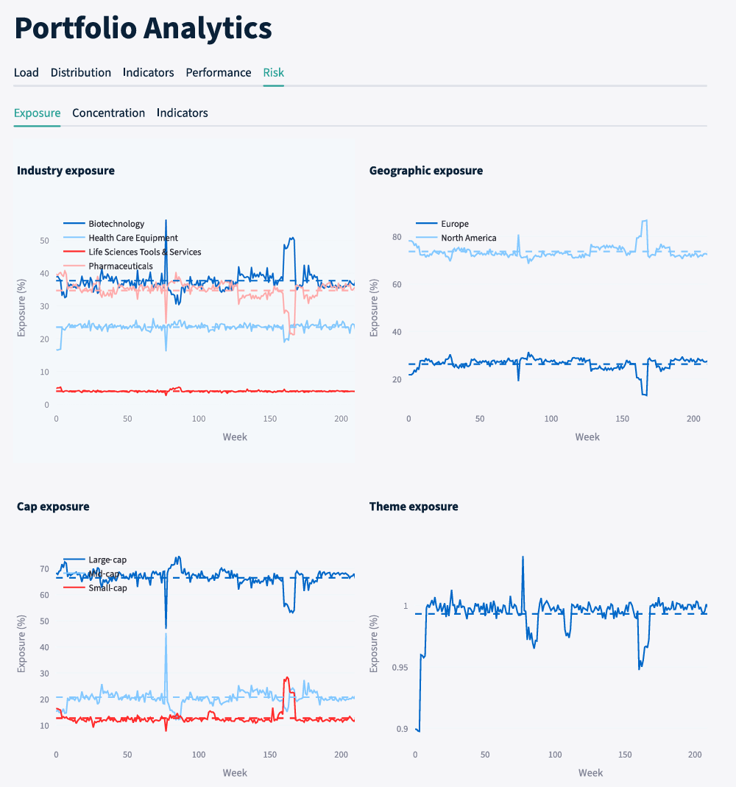

# Thematic Investment Portfolio Optimization Plateform

[](https://github.com/ValVal-Data/Thematic/actions/workflows/ci.yaml)

 
**Date:** October 2026  
**Purpose:** Educational investment research case study  

---

## 1.1 Disclaimer
This repository is provided solely for educational and illustrative purposes. It does not constitute investment advice, financial research, an offer, or a recommendation to buy or sell any financial instrument. Company names, securities, sectors and themes are used only to demonstrate a thematic investment research and portfolio-construction workflow.

## 1.2 Status

This project is under active development

A AI copilot is being implemented

### Roadmap
- [x] Implemented sqlite database
- [x] Thematic scoring interface
- [x] Portfolio Optimization interface
- [x] Analytics interface


  


- [ ] AI copilot implementation


## 1.3 Overview
This repository contains a thematic equity portfolio-construction project focused on cardiometabolic innovation. The objective is to demonstrate how scientific domain expertise, financial analysis and quantitative portfolio optimisation can be combined in a reproducible investment research workflow.

The project uses investable universe across pharmaceuticals, biotechnology, medical devices, life-science tools and manufacturing enablers. Companies are scored using a proprietary thematic framework incorporating theme exposure, pipeline maturity, pipeline breadth, differentiation, technological novelty, validation, partnerships, revenue scale, growth and ecosystem role.

Portfolio weights are optimised using a constrained Bayesian maximum-entropy framework. The optimisation seeks to enhance return and thematic exposure while limiting turnover through an entropy penalty relative to prior weights. The strategy is evaluated through turnover, transaction-cost impact, exposure stability, concentration metrics, rolling risk indicators and PCA-based factor decomposition.

To support reproducibility and operational scalability, the research framework has been implemented as a modular, production-ready analytics platform featuring SQL data integration, REST APIs, interactive dashboards, CI/CD pipelines and containerised deployment. The platform enables end-to-end portfolio construction, optimisation and performance analysis through a transparent and extensible architecture.

## 1.4 Project Objective
The project was designed to support my transition from a PhD in biophysics to finance by applying scientific reasoning, quantitative modelling and Python development to a realistic investment-management problem.

The central question is:
> Can a structured thematic investment process identify and construct a diversified equity portfolio exposed to cardiometabolic innovation while maintaining explicit risk and diversification constraints?


## 1.5 Table of Content
1. Executive summary
    1. Disclamer
    2. Status
    3. Overview
    4. Project Objective
    5. Table of Content
2. Key features
3. Data sources
4. Methodology
    1. Thematic Rationale
    2. Thematic Scoring
5. How to run the project
6. How to use the software
    1. Scoring
    2. Optimization
    3. Analysis
7. Limitations
8. Background and motivation
9. Project Structure
10. Future Improvements

# 2. Key features
- Proprietary company-level thematic scoring framework
- Bayesian maximum-entropy portfolio optimisation
- Explicit constraints on position size, industry exposure, volatility and Value-at-Risk
- Turnover and transaction-cost analysis
- Exposure, concentration and rolling risk diagnostics
- PCA-based factor decomposition versus global equity benchmarks
- End-to-end, deployment-ready architecture combining SQL data management, API connectivity, interactive analytics dashboards, CI/CD workflows, and containerized services.

# 3. Data sources
- **Clinical trial** - `https://clinicaltrials.gov/`. Taking: Active, not recruiting
- **Thematic score** - Companies website
- **Company financial** - Yahoo finance
- **Stock value** - Yahoo finance
- **Currency rate** - Yahoo finance

# 4. Methodology
## 4.1 Thematic Rationale

Cardiometabolic disease represents a major global health challenge, driven by ageing populations and lifestyle changes. The increasing prevalence of obesity, diabetes and cardiovascular disease creates sustained demand for effective treatment and prevention.

Recent advances in therapies, particularly in metabolic diseases, have significantly improved treatment outcomes and expanded the commercial opportunity. Innovation is not limited to drug development but extends across a broader ecosystem, including manufacturing, devices and research tools.

The investment approach aims to capture long-term structural demand, ongoing scientific innovation and value creation across the healthcare value chain.


## 4.2 Thematic Scoring
Companies are evaluated using a structured thematic scoring framework designed to measure both exposure to the theme and the quality of that exposure.

The score incorporates:

- Thematic purity  
- Pipeline maturity and breadth  
- Innovation and differentiation  
- Technological novelty  
- Validation and partnerships  
- Revenue scale and growth  
- Ecosystem role  

Categorical inputs are used where necessary to maintain consistency across companies.

$$Thematic Score = (Thematic Purity + Innovation Score)(1+Ecosystem Component),$$
with innovation score defined as:
$$Innovation Score = Pipeline Strength + Breakthrough Potential +  Number Of Active Partnerships,$$
and with pipeline strength and breakthrough potential defined as:
$$Pipeline Strength = Pipeline Maturity + Pipeline Breadth + Pipeline Differentiation,$$
$$Breakthrough Potential = Novelty + Validation,$$

The following component were used with each factor being from 0 to 100%

| Score | Category | Value | Definition |
|-------|----------|-------|------------|
| Thematic purity | N | 0% | Effectively 0% metabolic revenue |
| Thematic purity | L | 10% | Some exposure (products, pipeline, or tools) |
| Thematic purity | M | 30% | Important but not dominant, or mixed portfolio |
| Thematic purity | H | 60% | Cardiometabolic/metabolic is a core revenue driver |
| Pipeline Strength | PreClinical | 10% |  |
| Pipeline Strength | Phase 1 | 30% |  |
| Pipeline Strength | Phase 2 | 60% |  |
| Pipeline Strength | Phase 3 | 85% |  |
| Pipeline Strength | Approved | 100% |  |
| Pipeline Breadth | 0-1 | 10% |  |
| Pipeline Breadth | 2-3 | 30% |  |
| Pipeline Breadth | 4-6 | 60% |  |
| Pipeline Breadth | 7-10 | 80% |  |
| Pipeline Breadth | More than 10 | 100% |  |
| Pipeline Differentiation | N | 20% | Crowded space |
| Pipeline Differentiation | L | 40% | Incremental improvement |
| Pipeline Differentiation | M | 60% | Novel mechanism |
| Pipeline Differentiation | H | 80% | First-in-class |
| Pipeline Differentiation | VH | 100% | First-in-disease |
| Novelty of the technology | NA | 0% | No metabolic/cardiometabolic drugs |
| Novelty of the technology | N | 20% | New formulation |
| Novelty of the technology | L | 40% | Incremental improvement |
| Novelty of the technology | M | 60% | Novel mechanism |
| Novelty of the technology | H | 80% | First-in-class |
| Novelty of the technology | VH | 100%  | First-in-disease |
| Validation | N | 0% | None |
| Validation | L | 20% | Preclinical |
| Validation | M | 60% | Peer-reviewed publications |
| Validation | H | 80% | Strategic partnerships |
| Validation | VH | 100%  | Multiple high-quality validation |
| Number of active partnerships | N | 0%  | No visible partnering activity in metabolic/cardiometabolic |
| Number of active partnerships | L | 30% | A few deals, mostly small or historic |
| Number of active partnerships | M | 60% | Regular partnering, visible in recent years |
| Number of active partnerships | H | 90% | Partnering is a core part of the business model |
| Revenue | Small cap | 0% | < $500M |
| Revenue | Medium cap | 50% | < $5B |
| Revenue | Large cap | 100% | > $5B |
| Growth metrics | Revenue CAGR | % |  |
| Ecosystem component | C | 5% | Core Innovator |
| Ecosystem component | E | 3% | Enabler |
| Ecosystem component | A | 0% | Adopter |


# 5. How to run the project
1. **Add your `Universe.txt` files to the `backend/data` folder**  
    - See **4.ii Thematic scoring** for exact scoring
    Each company is define by a line with the following values separated by `,`
    - **Name** - Name of the company
    - **Ticker** - Ticker code
    - **Market** - Market code
    - **CAGR** - CAGR in %
    - **Revenue** - Revenue in milions in the currency of the market
    - **Thematic** - Thematic purity in %
    - **Pipeline Maturity** - Highest clinical trial reached
    - **Pipeline Breadth** - Number of active clinical trial
    - **Pipeline Differentiation** - Type of improvement
    - **Novelty of the technology** - Current technology edge
    - **Validation** - Current validation stage
    - **Number of active partnerships** - Estimation of number of partnership
    - **Ecosystem component** - Type of the company in the ecosystem
    - **Sector** - Sector of the company
    - **Industry** - Industry of the company
2. **Add your `Exrate.json` files to the `backend/config` folder** 
    - "`Currency/CHF`": `Rate`,
3. **Add your data files to the `backend/data` folder**  
    File name format: `Name_Currency_Dividend_Type.dat`  
    - **Name** - Identifier of the asset being tracked  
    - **Currency** - 3‑letter ISO currency code  
    - **Dividend** - `Dis` (Distribution) or `Acc` (Accumulation)  
    - **Type** - `Close` (closing price), `Div` (dividend), or `Cur` (currency rate)  
    - For currency pairs, use the format **Foreign-Local** (e.g., `USD-CHF`)  
    - Exchange rates must be expressed as **Foreign / Local**
    Each data file must contain two columns:
    - The first column is the date in `DD‑MM‑YYYY` format.
    - The second column is the corresponding value.
    - The first row must contain the headers: `Date` and `Value`.
    - Columns must be separated by two spaces.
4. **Build the image**  
    Execute: `Docker compose build --no-cache`
5. **Start the image**  
    Execute: `Docker compose up -d`
6. **Open the software on your browser**  
    Go to: `localhost:8501`

# 6. How to use the software
## 6.1 Scoring
Navigate to Score to evaluate companies using the proprietary cardiometabolic thematic framework.  
  


The scoring model assesses multiple dimensions including:
- Theme exposure
- Pipeline maturity
- Pipeline breadth
- Competitive differentiation
- Technological novelty
- Clinical and commercial validation
- Strategic partnerships
- Revenue scale
- Growth potential
- Ecosystem importance
- Available Actions
- Review company-level scores
- Inspect individual scoring components
- Modify factor weights
- Adjust minimum score thresholds
- Analyse score distributions and rankings

The resulting scores determine which companies are eligible for portfolio construction.

## 6.2 Optimization
Navigate to Optimise to generate portfolio allocations.



The optimisation engine uses a constrained Bayesian maximum-entropy framework designed to:
- Increase exposure to high-conviction companies
- Preserve diversification
- Control concentration risk
- Limit turnover from prior allocations
- Respect user-defined investment constraints


## 6.3 Analysis
To analyse a portfolio run, navigate to the Analysis tab and enter the corresponding job ID in the input field.

  

Once the run has been loaded, you can review its performance and risk characteristics.
  

Additional portfolio composition and allocation information is available in the Distribution tab.

Available analyses include:
- Turnover analysis
- Benchmark comparison against the S&P 500
- PCA-based factor analysis
- Exposure analysis by industry, geography, weight, and market capitalisation
- Concentration
- Concentration exposure (HHI index, CRx)


# 7. Limitations
The analysis has several limitations:
- Reliance on historical data  
- Uncertainty in clinical and regulatory outcomes  
- Simplified assumptions in thematic scoring  
- Absence of valuation analysis  
- No macroeconomic or currency modelling  

Drug development is inherently uncertain, and results should be interpreted with caution.


# 8. Background and motivation
This project was developed as part of my transition from a PhD in biophysics to finance, with the objective of applying scientific reasoning, quantitative modelling and programming skills to a realistic investment-management context.

My academic background provided strong exposure to data analysis, statistical modelling and complex systems, as well as a deep understanding of life sciences. This naturally led me to focus on healthcare as a sector where domain expertise can inform investment decisions.

The project was designed to move beyond theoretical knowledge and to replicate a simplified version of an institutional investment process. This includes defining a theme, constructing an investable universe, evaluating companies through a structured framework, building a portfolio under explicit constraints, and analysing performance and risk.

Cardiometabolic innovation was selected as the focal theme due to its combination of structural demand, scientific progress and economic relevance. It represents an area where life-science knowledge and financial analysis can be meaningfully combined.

The work evolved iteratively, with successive refinements to the scoring methodology, portfolio construction and risk framework. This process highlighted the importance of data quality, model assumptions and constraint design in shaping portfolio outcomes.

Overall, this project reflects my interest in applying a quantitative and research-driven approach to investment problems, particularly in areas where scientific and economic factors intersect.

# 9. Project Structure
```
Thematic/
|-- backend/
  |-- common/
  |-- data/
  |-- database/
  |-- results/
  |-- routers/
  |-- services/
  |-- tests/
  |-- Dockerfile
  |-- conda-lock.yml
  |-- main.py
  `-- pyproject.toml
|-- frontend/
  |-- pages/
  |-- theme/
  |-- utils/
  |-- Dockerfile
  |-- conda-lock.yml
  |-- app.py
  `-- pyproject.toml
|-- figures/
|-- docker-compose.yaml
`-- README.md
```

# 12. Future Improvements
- Make return prediction based on announcement
- Dashboard
