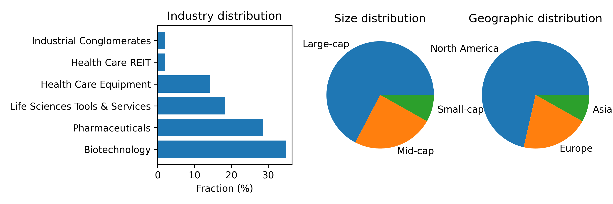
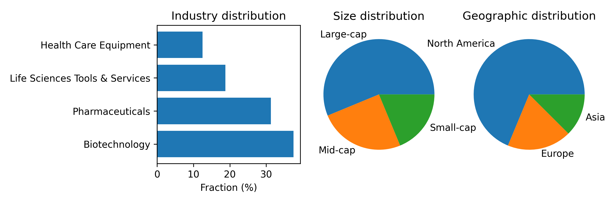
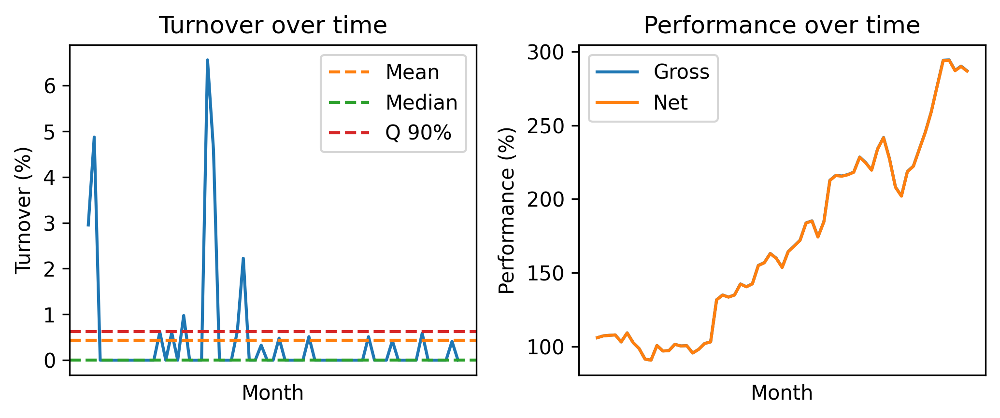
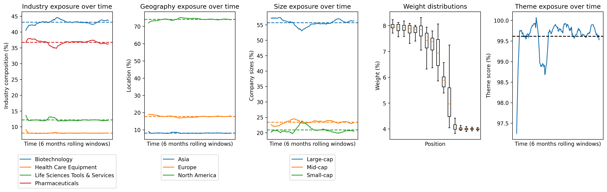
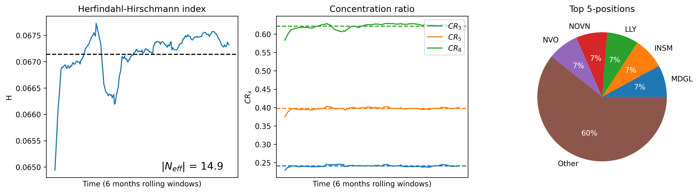
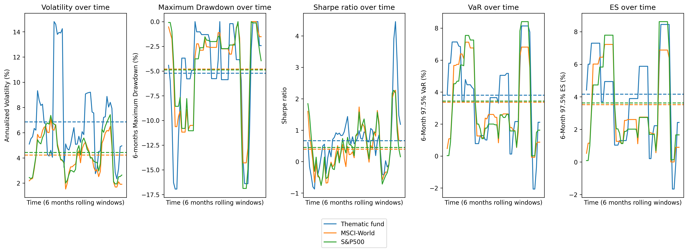
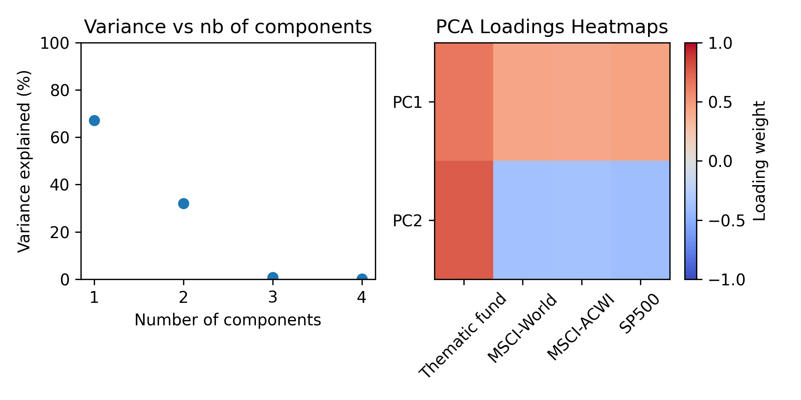

# GLP-1 Thematic Investment portfolio

 
**Date:** 17 May 2026  
**Purpose:** Educational investment research case study  

---

## 1.1 Disclaimer
This repository is provided solely for educational and illustrative purposes. It does not constitute investment advice, financial research, an offer, or a recommendation to buy or sell any financial instrument. Company names, securities, sectors and themes are used only to demonstrate a thematic investment research and portfolio-construction workflow.

## 1.2 Overview
This repository contains a thematic equity portfolio-construction project focused on cardiometabolic innovation. The objective is to demonstrate how scientific domain expertise, financial analysis and quantitative portfolio optimisation can be combined in a reproducible investment research workflow.

The project builds a 50-company investable universe across pharmaceuticals, biotechnology, medical devices, life-science tools and manufacturing enablers. Companies are scored using a proprietary thematic framework incorporating theme exposure, pipeline maturity, pipeline breadth, differentiation, technological novelty, validation, partnerships, revenue scale, growth and ecosystem role.

A subset of 16 equities is selected while preserving the industry structure of the broader universe. Portfolio weights are then optimised using a constrained Bayesian maximum-entropy framework. The optimisation seeks to enhance return and thematic exposure while limiting turnover through an entropy penalty relative to prior weights.

The strategy is evaluated through turnover, transaction-cost impact, exposure stability, concentration metrics, rolling risk indicators and PCA-based factor decomposition. The results suggest that the portfolio captured a differentiated cardiometabolic innovation factor during the analysed period, while maintaining explicit constraints on position size, industry exposure, volatility and tail risk.

This project is intended as an educational research case study and not as investment advice.

## 1.3 Project Objective
The project was designed to support my transition from a PhD in biophysics to finance by applying scientific reasoning, quantitative modelling and Python development to a realistic investment-management problem.

The central question is:
> Can a structured thematic investment process identify and construct a diversified equity portfolio exposed to cardiometabolic innovation while maintaining explicit risk and diversification constraints?


## 1.4 Table of Content
1. Executive summary
    1. Disclamer
    2. Overview
    3. Project Objective
    4. Table of Content
2. Key features
3. Data sources
4. Methodology
    1. Investment Universe
    2. Thematic Rationale
    3. Thematic Scoring
    4. Equity Selection
    5. Portfolio Optimization
    6. Constraints
5. How to run the project
6. Results
    1. Universe Analysis
    2. Portfolio Construction
    3. Turnover
    4. Exposure
    5. Concentration
    6. Risk Analysis
    7. Factor Analysis
    8. Performance
7. Limitations
8. Background and motivation
9. Project Structure
10. Future Improvements

# 2. Key features
- Construction of a 50-company cardiometabolic innovation universe
- Integration of public fund holdings, thematic indices and bottom-up sector research
- Proprietary company-level thematic scoring framework
- Selection of 16 equities while preserving industry representation
- Bayesian maximum-entropy portfolio optimisation
- Explicit constraints on position size, industry exposure, volatility and Value-at-Risk
- Turnover and transaction-cost analysis
- Exposure, concentration and rolling risk diagnostics
- PCA-based factor decomposition versus global equity benchmarks
- Fully reproducible Python workflow


# 3. Data sources
- **Clinical trial** - `https://clinicaltrials.gov/`. Taking: Active, not recruiting
- **Thematic score** - Companies website
- **Company financial** - Yahoo finance
- **Stock value** - Yahoo finance
- **Currency rate** - Yahoo finance

# 4. Methodology
## 4.1 Investment universe
The investment universe consists of 50 publicly listed companies selected from:
- Healthcare funds  
- Thematic indices  
- Additional sector research  

The universe includes companies across:
- Pharmaceuticals  
- Biotechnology  
- Medical devices  
- Life-science tools  
- Manufacturing  

The objective was to capture the cardiometabolic innovation ecosystem while maintaining sufficient diversification across industries and regions.

## 4.2 Thematic Rationale

Cardiometabolic disease represents a major global health challenge, driven by ageing populations and lifestyle changes. The increasing prevalence of obesity, diabetes and cardiovascular disease creates sustained demand for effective treatment and prevention.

Recent advances in therapies, particularly in metabolic diseases, have significantly improved treatment outcomes and expanded the commercial opportunity. Innovation is not limited to drug development but extends across a broader ecosystem, including manufacturing, devices and research tools.

The investment approach aims to capture long-term structural demand, ongoing scientific innovation and value creation across the healthcare value chain.


## 4.3 Thematic Scoring
Companies are evaluated using a structured thematic scoring framework designed to measure both exposure to the theme and the quality of that exposure.

The score incorporates:

- Thematic purity  
- Pipeline maturity and breadth  
- Innovation and differentiation  
- Technological novelty  
- Validation and partnerships  
- Revenue scale and growth  
- Ecosystem role  

Categorical inputs are used where necessary to maintain consistency across companies.

$$Thematic Score = (50\% Thematic Purity + 30\% Innovation Score)(1+Ecosystem Component),$$
with innovation score defined as:
$$Innovation Score = 40\% Pipeline Strength + 40\% Breakthrough Potential + 20\% Number Of Active Partnerships,$$
and with pipeline strength and breakthrough potential defined as:
$$Pipeline Strength = 50\% Pipeline Maturity + 35\% Pipeline Breadth + 15\% Pipeline Differentiation,$$
$$Breakthrough Potential = 70\% Novelty + 30\% Validation,$$

The following component were used with each factor being from 0 to 100%

| Score | Category | Value | Definition |
|-------|----------|-------|------------|
| Thematic purity | N | 0% | Effectively 0% metabolic revenue |
| Thematic purity | L | 10% | Some exposure (products, pipeline, or tools) |
| Thematic purity | M | 30% | Important but not dominant, or mixed portfolio |
| Thematic purity | H | 60% | Cardiometabolic/metabolic is a core revenue driver |
| Pipeline Strength | PreClinical | 10% |  |
| Pipeline Strength | Phase 1 | 30% |  |
| Pipeline Strength | Phase 2 | 60% |  |
| Pipeline Strength | Phase 3 | 85% |  |
| Pipeline Strength | Approved | 100% |  |
| Pipeline Breadth | 0-1 | 10% |  |
| Pipeline Breadth | 2-3 | 30% |  |
| Pipeline Breadth | 4-6 | 60% |  |
| Pipeline Breadth | 7-10 | 80% |  |
| Pipeline Breadth | More than 10 | 100% |  |
| Pipeline Differentiation | N | 20% | Crowded space |
| Pipeline Differentiation | L | 40% | Incremental improvement |
| Pipeline Differentiation | M | 60% | Novel mechanism |
| Pipeline Differentiation | H | 80% | First-in-class |
| Pipeline Differentiation | VH | 100% | First-in-disease |
| Novelty of the technology | NA | 0% | No metabolic/cardiometabolic drugs |
| Novelty of the technology | N | 20% | New formulation |
| Novelty of the technology | L | 40% | Incremental improvement |
| Novelty of the technology | M | 60% | Novel mechanism |
| Novelty of the technology | H | 80% | First-in-class |
| Novelty of the technology | VH | 100%  | First-in-disease |
| Validation | N | 0% | None |
| Validation | L | 20% | Preclinical |
| Validation | M | 60% | Peer-reviewed publications |
| Validation | H | 80% | Strategic partnerships |
| Validation | VH | 100%  | Multiple high-quality validation |
| Number of active partnerships | N | 0%  | No visible partnering activity in metabolic/cardiometabolic |
| Number of active partnerships | L | 30% | A few deals, mostly small or historic |
| Number of active partnerships | M | 60% | Regular partnering, visible in recent years |
| Number of active partnerships | H | 90% | Partnering is a core part of the business model |
| Revenue | Small cap | 0% | < $500M |
| Revenue | Medium cap | 50% | < $5B |
| Revenue | Large cap | 100% | > $5B |
| Growth metrics | Revenue CAGR | % |  |
| Ecosystem component | C | 5% | Core Innovator |
| Ecosystem component | E | 3% | Enabler |
| Ecosystem component | A | 0% | Adopter |

## 4.4 Equity Selection
The final portfolio consists of 16 equities selected based on thematic scores.

Selection is performed within each industry group to preserve the overall industry structure of the investment universe. This ensures diversification while maintaining exposure to the most relevant companies within the theme.


## 4.5 Portfolio Optimization
Portfolio weights are determined using a Bayesian maximum-entropy framework.

The objective is to improve expected return and thematic exposure while minimising unnecessary changes in portfolio allocation. The optimisation starts from prior weights and applies a penalty to large deviations, resulting in lower turnover.

The optimisation is solved under explicit constraints to ensure diversification and risk control.


## 4.6 Constraints
The portfolio is subject to the following constraints:

- Position size: 4% – 8%  
- Industry exposure capped relative to universe  
- Annualised volatility: < 20%  
- 1-month 97.5% Value-at-Risk: < 6%  

These constraints are designed to limit concentration and maintain an institutionally consistent risk profile.


# 5. How to run the project
1. **Create a python virtual environment**
2. **Install dependencies**
    - Run: `pip install -r Requirements.txt`
3. **Add your `Universe.txt` files to the `Data` folder**  
    - See **4.ii Thematic scoring** for exact scoring
    Each company is define by a line with the following values separated by `,`
    - **Name** - Name of the company
    - **Ticker** - Ticker code
    - **Market** - Market code
    - **CAGR** - CAGR in %
    - **Revenue** - Revenue in milions in the currency of the market
    - **Thematic** - Thematic purity in %
    - **Pipeline Maturity** - Highest clinical trial reached
    - **Pipeline Breadth** - Number of active clinical trial
    - **Pipeline Differentiation** - Type of improvement
    - **Novelty of the technology** - Current technology edge
    - **Validation** - Current validation stage
    - **Number of active partnerships** - Estimation of number of partnership
    - **Ecosystem component** - Type of the company in the ecosystem
    - **Sector** - Sector of the company
    - **Industry** - Industry of the company
4. **Add your `Exrate.json` files to the `Config` folder** 
    - "`Currency/CHF`": `Rate`,
5. **Add your data files to the `Data` folder**  
    File name format: `Name_Currency_Dividend_Type.dat`  
    - **Name** - Identifier of the asset being tracked  
    - **Currency** - 3‑letter ISO currency code  
    - **Dividend** - `Dis` (Distribution) or `Acc` (Accumulation)  
    - **Type** - `Close` (closing price), `Div` (dividend), or `Cur` (currency rate)  
    - For currency pairs, use the format **Foreign-Local** (e.g., `USD-CHF`)  
    - Exchange rates must be expressed as **Foreign / Local**
    Each data file must contain two columns:
    - The first column is the date in `DD‑MM‑YYYY` format.
    - The second column is the corresponding value.
    - The first row must contain the headers: `Date` and `Value`.
    - Columns must be separated by two spaces.
6. **Run the main notebook**  
    Open and execute: `Main.ipynb`

# 6. Results
## 6.1 Universe Analysis

The investment universe provides diversified exposure across multiple industries and regions, while remaining concentrated in key innovation segments such as pharmaceuticals and biotechnology.
## 6.2 Portfolio Construction

The selected portfolio maintains the industry structure of the universe while incorporating a mix of company sizes and geographies.
## 6.3 Turnover

Turnover remains limited due to the entropy-based optimisation framework. The difference between gross and net performance indicates that transaction costs have a limited impact on results.
## 6.4 Exposure

Industry exposure remains stable over time, consistent with imposed constraints. Geographic and size exposures also exhibit limited variation despite not being explicitly constrained.
## 6.5 Concentration

Concentration metrics confirm a diversified allocation. Position limits and industry constraints prevent excessive concentration in individual holdings or sectors.
## 6.6 Risk Analysis

The portfolio exhibits higher volatility than broad equity indices, consistent with its thematic focus. However, downside risk remains broadly aligned with defined constraints.
## 6.7 Factor Analysis

Principal Component Analysis suggests that portfolio returns are not solely driven by general market exposure but also reflect a theme-specific component.
---

<table border="1" class="dataframe">
  <thead>
    <tr style="text-align: right;">
      <th></th>
      <th>Fund</th>
    </tr>
  </thead>
  <tbody>
    <tr>
      <th>Alpha</th>
      <td>0.0</td>
    </tr>
    <tr>
      <th>Beta,Market</th>
      <td>65.2</td>
    </tr>
    <tr>
      <th>Beta,Theme</th>
      <td>75.8</td>
    </tr>
    <tr>
      <th>Track</th>
      <td>0.3</td>
    </tr>
    <tr>
      <th>r2</th>
      <td>1.0</td>
    </tr>
  </tbody>
</table>

## 6.8 Performance
It was possible then to model the data using these axes with a correlation of 1 and very little tracking error. This allows us to confirm that the fund was able to generate returns beyond general market movements.

<table border="1" class="dataframe">
  <thead>
    <tr style="text-align: right;">
      <th></th>
      <th>Thematic fund</th>
      <th>MSCI-World</th>
      <th>MSCI-ACWI</th>
      <th>S&amp;P-500</th>
    </tr>
  </thead>
  <tbody>
    <tr>
      <th>Annualized return (%)</th>
      <td>24.3</td>
      <td>4.9</td>
      <td>4.2</td>
      <td>6.5</td>
    </tr>
    <tr>
      <th>Annualized volatility (%)</th>
      <td>19.3</td>
      <td>11.8</td>
      <td>11.4</td>
      <td>12.4</td>
    </tr>
    <tr>
      <th>Maximum Drawdown (%)</th>
      <td>-16.9</td>
      <td>-19.5</td>
      <td>-20.3</td>
      <td>-16.9</td>
    </tr>
    <tr>
      <th>Sharpe ratio</th>
      <td>1.3</td>
      <td>0.4</td>
      <td>0.4</td>
      <td>0.5</td>
    </tr>
    <tr>
      <th>1-Month 97.5% VaR</th>
      <td>6.6</td>
      <td>6.6</td>
      <td>6.5</td>
      <td>7.3</td>
    </tr>
    <tr>
      <th>1-Month 97.5% ES</th>
      <td>7.9</td>
      <td>7.0</td>
      <td>6.8</td>
      <td>8.2</td>
    </tr>
  </tbody>
</table>
The thematic portfolio outperforms global equity benchmarks on a return basis over the analysed period. This outperformance is achieved with higher volatility, which remains within the expected range for a concentrated thematic strategy.

The Sharpe ratio indicates improved risk-adjusted performance relative to benchmarks. Downside risk, as measured by Value-at-Risk and Expected Shortfall, remains broadly comparable, suggesting that excess returns are not solely driven by disproportionate tail-risk exposure.

These results support the view that the portfolio captures a differentiated source of return while maintaining a controlled risk profile. They should, however, be interpreted with caution given the favourable sector dynamics during the analysed period.


# 7. Limitations
The analysis has several limitations:
- Reliance on historical data  
- Uncertainty in clinical and regulatory outcomes  
- Simplified assumptions in thematic scoring  
- Absence of valuation analysis  
- No macroeconomic or currency modelling  

Drug development is inherently uncertain, and results should be interpreted with caution.


# 8. Background and motivation
This project was developed as part of my transition from a PhD in biophysics to finance, with the objective of applying scientific reasoning, quantitative modelling and programming skills to a realistic investment-management context.

My academic background provided strong exposure to data analysis, statistical modelling and complex systems, as well as a deep understanding of life sciences. This naturally led me to focus on healthcare as a sector where domain expertise can inform investment decisions.

The project was designed to move beyond theoretical knowledge and to replicate a simplified version of an institutional investment process. This includes defining a theme, constructing an investable universe, evaluating companies through a structured framework, building a portfolio under explicit constraints, and analysing performance and risk.

Cardiometabolic innovation was selected as the focal theme due to its combination of structural demand, scientific progress and economic relevance. It represents an area where life-science knowledge and financial analysis can be meaningfully combined.

The work evolved iteratively, with successive refinements to the scoring methodology, portfolio construction and risk framework. This process highlighted the importance of data quality, model assumptions and constraint design in shaping portfolio outcomes.

Overall, this project reflects my interest in applying a quantitative and research-driven approach to investment problems, particularly in areas where scientific and economic factors intersect.

# 9. Project Structure
```
Thematic/
|-- Config/
|   |-- Convert.json
|   `-- Scoring.json
|-- Data/
|-- Figures/
|-- Results/
|-- Source/
|   |-- Score.py
|   |-- Plot.py
|   |-- StatTest.py
|   |-- PortfolioOptimization.py
|   `-- Utils.py
|-- Main.ipynb
|-- README.txt
`-- Requirements.txt
```

# 12. Future Improvements
- Make return prediction based on announcement
- Dashboard